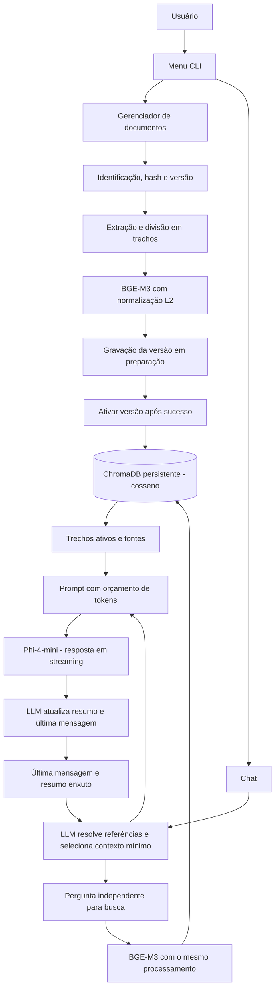

# T01 - Configuração validada e entrada executável

> **Instruções do projeto:** nenhuma AGENTS.md ou convenção local foi encontrada na inspeção inicial; conferir novamente antes de implementar. [Plano vigente](../implementation_plan.md).
> **Status:** Código implementado; validação externa registrada em docs/validation.md
> **Progresso:** código entregue; critérios externos conforme relatório
> **Início:** - | **Fim previsto:** - | **Fim real:** -
> **Responsável:** Codex
> **Dependências:** Nenhuma
> **Commit único:** `feat(config): add validated settings and application entry point`

## 1. Por que

Estabelecer uma aplicação executável com configurações seguras e caminhos previsíveis; o comando inicial mostra configuração sem carregar modelos.

Uma tarefa corresponde a um único commit com código, testes e documentação diretamente afetada. Os predecessores continuam funcionais se esta tarefa for revertida; funcionalidades consumidoras posteriores devem ser revertidas antes de suas dependências.

## 2. Referencia exata no plano

Plano: [implementation_plan.md](../implementation_plan.md)

Trecho literal da seção **## 1. Arquitetura**:

<!-- PLAN_EXCERPT_START -->
````text
## 1. Arquitetura

```text
personal-simple-light-rag/
├── data/
│   ├── chroma/                 # Índice vetorial persistente
│   ├── catalog.sqlite3         # Documentos, versões e estado da ingestão
│   └── uploads/                # Cache opcional de arquivos
├── models/                     # GGUF e cache dos embeddings
├── src/
│   ├── config.py               # Configuração validada e caminhos
│   ├── models/
│   │   ├── downloader.py       # Downloads e verificação dos artefatos
│   │   ├── llm.py              # llama-cpp-python; CUDA padrão, CPU opcional
│   │   └── embeddings.py       # BGE-M3 normalizado; CUDA padrão, CPU opcional
│   ├── rag/
│   │   ├── loaders.py          # PDF, TXT e Markdown com metadados
│   │   ├── splitter.py         # Divisão recursiva com limites explícitos
│   │   ├── catalog.py          # Identidade, hashes e versões dos documentos
│   │   ├── vectorstore.py      # ChromaDB, busca por cosseno e CRUD
│   │   ├── memory.py           # Última mensagem e resumo enxuto pela LLM
│   │   ├── query_resolver.py   # Resolução contextual de perguntas pela LLM
│   │   └── pipeline.py         # Busca, orçamento de contexto e resposta
│   └── ui/
│       ├── console.py          # Rich
│       ├── menu.py             # Menu interativo
│       ├── chat.py             # Streaming e fontes
│       └── ingestion.py        # Adição, atualização, exclusão e progresso
├── scripts/                    # Preparação para CUDA ou CPU
├── tests/
├── main.py
├── pyproject.toml              # Pacote e comando de entrada
├── requirements.txt            # Dependências comuns fixadas
├── .env.example
└── README.md
```


````
<!-- PLAN_EXCERPT_END -->

Trecho literal da seção **### 3.2. Configuração e downloads**:

<!-- PLAN_EXCERPT_START -->
````text
### 3.2. Configuração e downloads

Exemplo de parâmetros iniciais, sujeitos a validação e benchmarks:

```dotenv
MODEL_REPO_ID=unsloth/Phi-4-mini-instruct-GGUF
MODEL_FILENAME=Phi-4-mini-instruct.Q8_0.gguf
````
<!-- PLAN_EXCERPT_END -->

## 3. Arquivos e ações

| Tipo | Arquivo | Ação |
|---|---|---|
| Código/configuração propostos | `pyproject.toml` | Criar ou modificar conforme os predecessores |
| Código/configuração propostos | `requirements.txt` | Criar ou modificar conforme os predecessores |
| Código/configuração propostos | `src/__init__.py` | Criar ou modificar conforme os predecessores |
| Código/configuração propostos | `src/config.py` | Criar ou modificar conforme os predecessores |
| Código/configuração propostos | `main.py` | Criar ou modificar conforme os predecessores |
| Código/configuração propostos | `.env.example` | Criar ou modificar conforme os predecessores |
| Teste proposto | `tests/test_config.py` | Criar ou modificar conforme os predecessores |
| Documentação | `README.md` | Criar ou modificar conforme os predecessores |

**Fato verificado:** inicialmente existe somente `implementation_plan.md`, sem código, testes, README ou repositório Git. Os caminhos acima são propostas de implementação; conferir os arquivos criados pelos predecessores antes de alterá-los. Usar funções pytest; nenhuma classe de teste existente foi presumida.

## 4. Como implementar

1. Criar pacote mínimo e entrada `python main.py --status`, com imports sem efeitos de download ou inferência. Separar dependências mínimas de teste das dependências pesadas dos perfis.
2. Validar defaults CUDA, perfil CPU explícito, limites positivos, overlap menor que tamanho do chunk, reserva de tokens menor que contexto e valores permitidos para memória/backend.
3. Resolver caminhos pela raiz da aplicação. Manter CUDA como padrão mesmo sem GPU; status deve dizer que ainda não houve validação de hardware.
4. Preencher `.env.example` e README com comando de entrada. Revisões definitivas dos modelos permanecem uma condição pendente para T03, sem inventar hashes.

## 5. Testes no mesmo commit

- Defaults preservam `Phi-4-mini-instruct.Q8_0.gguf`, CUDA e `n_gpu_layers=-1`.
- Perfil CPU produz `n_gpu_layers=0` e embeddings CPU; configuração contraditória é rejeitada.
- Mudança de diretório atual não muda os caminhos; limites inválidos retornam erro acionável.
- Entrada de status roda sem carregar torch, GGUF ou modelos.

Testes simulados validam contratos e ramos de erro. Testes de persistência usam os bancos reais em diretórios temporários. Testes com modelos/rede/hardware são opt-in (`integration_models`), devem ser declarados no pytest e têm gates externos: uma execução com skip não constitui aprovação desses gates.

## 6. Comandos de validação

Executar da raiz do projeto, no ambiente virtual do perfil preparado. Estes comandos são **previstos para a implementação**, não foram executados como testes de produção durante a decomposição.

```powershell
python -m pytest tests/test_config.py -q
python -m pytest -m "not integration_models" -q
python -m compileall -q src main.py
python scripts/verify_plan_excerpts.py tasks --plan implementation_plan.md
```

Quando houver cenários opt-in nesta tarefa, executar também os arquivos focados com `-m integration_models` no ambiente real correspondente e guardar o resultado. Gates manuais, como Windows limpo ou avaliação de fundamentação, devem ter registro separado.

## 7. Gates e fora de escopo

- Não inicializar Git nem criar commits nesta decomposição. A tarefa prevê um commit quando o projeto for inicializado.
- Fora de escopo: instalação dos backends, downloads e menu completo.

- Não iniciar dependências posteriores para fazer esta tarefa passar; código e testes desta tarefa devem funcionar junto aos predecessores concluídos.
- Atualizar somente documentação diretamente afetada e preservar alterações alheias.

## 8. Critérios de aceitação

- [ ] Configuração e comando de status funcionam sem inferência.
- [ ] CUDA continua sendo o padrão e CPU é explícita.
- [x] Código e configuração desta tarefa implementados e executáveis.
- [x] Testes deste comportamento incluídos e aprovados no mesmo commit.
- [x] Documentação diretamente afetada atualizada.
- [x] Excertos e links validados; dependências anteriores concluídas.
- [ ] Gates externos têm evidência ou bloqueio explícito, sem dados fabricados.
- [x] Um commit criado com a mensagem prevista, quando houver repositório Git.

---

## Progresso final da implementação

| Item | Status |
|---|---|
| Implementação | Implementada |
| Testes | Automatizados aprovados; modelos reais conforme relatório |
| Documentação de uso | Atualizada |
| Validação real/gates | Pendente |
| Commit | Commit desta tarefa |

**Progresso geral:** código entregue; gates reais pendentes/conforme relatório
**Critérios concluídos:** 5/8 (gates reais avaliados no relatório)
**Evidências de execução:** pytest focado, compileall e verificador literal aprovados neste commit. Validações de hardware/modelos em `docs/validation.md`; skips não são aprovação.
